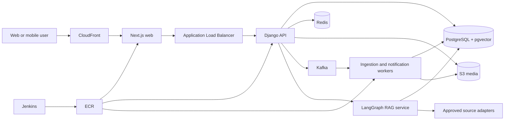

# Anime Search Platform Architecture

## Product boundary

Anime Search is an anime-only discovery, community, and knowledge platform. Anonymous visitors can search, browse trends, compare ratings, inspect characters and relationships, find legal viewing options, and read source-backed summaries. Signed-in users can maintain lists, rate titles, comment, join conversations, tune recommendations, and use personalized AI features.

The first release prioritizes reliable discovery. Community, AI, media galleries, and large-scale event infrastructure are introduced behind feature flags after the catalogue and search quality are measurable.

## Chosen stack

| Layer | Choice | Responsibility |
| --- | --- | --- |
| Web | Next.js with React and TypeScript | Accessible UI, routing, server rendering, SEO, social cards |
| API | Django, Django REST Framework | Domain rules, identity, permissions, aggregation, moderation |
| Primary database | PostgreSQL | Users, titles, characters, lists, ratings, comments, source records |
| Vector search | pgvector | Source chunks and semantic retrieval without another database |
| Cache | Redis | Response cache, distributed locks, throttles, sessions, job state |
| Search | PostgreSQL full-text initially; OpenSearch when justified | Facets, typo tolerance, ranking, autocomplete |
| Events | Kafka | Durable domain events, ingestion fan-out, notifications, analytics |
| Background jobs | Celery workers | Scheduled imports, image processing, notifications, embeddings |
| AI orchestration | LangGraph with selected LangChain integrations | Explicit RAG state machine, tools, retries, citations, evaluations |
| Authentication | Google OAuth plus application sessions | Default sign-in and account ownership |
| Media | S3 and CloudFront | Wallpapers, permitted artwork, avatars, generated social cards |
| Containers | Docker | Repeatable local, CI, staging, and production images |
| Delivery | Jenkins | Test, scan, build, publish, migrate, deploy, verify, rollback |
| AWS runtime | ECS behind ALB, RDS PostgreSQL, ElastiCache, S3/CloudFront | Managed production infrastructure with horizontal scaling |
| Observability | OpenTelemetry, CloudWatch, Sentry, Prometheus/Grafana as needed | Traces, logs, errors, service and product metrics |

MongoDB is intentionally excluded. Login records, lists, ratings, comments, conversations, and moderation data are relational and belong in PostgreSQL. JSONB covers provider payloads that need flexible storage.

Kafka is not a cache and does not directly make HTTP connections faster. Redis serves hot reads and throttling. Kafka carries durable events such as `catalog.title.updated`, `user.rating.created`, `watchlist.changed`, and `notification.requested`. We will not require Kafka in the earliest single-service development loop; the event contract exists first, then Kafka is enabled when asynchronous consumers appear.

## Service boundaries

The initial deployment can run web, API, worker, PostgreSQL, and Redis through Docker Compose. Production uses managed AWS services. OpenSearch and managed Kafka are activated only after measured traffic or search requirements justify their cost.

## Data-source strategy

Wikidata is the canonical discovery feed. Its structured facts are CC0 and are normalized behind the Django adapter so browser clients do not call Wikimedia directly. Attributed Wikipedia extracts may enrich summaries, while Wikimedia Commons files are displayed only with their per-file creator, source, and licence metadata. Anime Index stores its own ratings and activity signals. The application does not depend on AniList, Jikan, scraped MyAnimeList data, or copied platform scores.

Streaming availability is region-sensitive and volatile. Every offer stores provider, region, access type (`subscription`, `free_with_ads`, `rent`, `buy`, or `official_free`), URL, source, and `verified_at`. The UI never labels an unverified third-party upload as legal. Links expire from display when their verification window passes.

Anime Index ratings are calculated only from reviews submitted on this platform, with vote counts shown beside the score. External rating pages may be linked for reference but their values are not copied into the catalogue.

## AI and RAG

AI answers are built from stored source documents and current structured catalogue records. Retrieval applies title identity, language, freshness, source quality, and spoiler-level filters before vector ranking. Each answer returns citations and an `as_of` timestamp. If retrieval is weak or a provider is unavailable, the application returns structured catalogue data or says evidence is insufficient.

LangGraph owns the workflow:

1. classify intent and spoiler boundary;
2. resolve title and character entities;
3. translate discovery requests into validated filters;
4. retrieve structured records and approved source chunks;
5. generate an answer with citations;
6. verify every claim has evidence;
7. record latency, model, prompt version, tokens, cost, and evaluation signals.

MCP can expose narrow internal tools to the agent, such as `search_titles`, `get_character`, `get_availability`, and `retrieve_sources`. It is an interface boundary, not a replacement for authentication, the API, or the retrieval pipeline.

Google OAuth provides identity. A ChatGPT subscription cannot be used as application API credit and the app cannot retrieve a user's ChatGPT token. The launch model uses a server-side project key with per-user quotas. A later bring-your-own-key mode may accept an API key through a server-only encrypted vault, but never browser storage or logs.

## Jenkins delivery

Jenkins uses a multibranch pipeline and short-lived AWS credentials through workload identity or tightly scoped credentials binding. Pull requests run checks and create an ephemeral preview when configured. The main branch pipeline is:

1. install dependencies from locked files;
2. lint, type-check, unit test, API integration test, and build;
3. run dependency, secret, container, and Django deployment checks;
4. build immutable web, API, and worker images tagged with the Git SHA;
5. push images to Amazon ECR;
6. deploy the SHA to staging;
7. run database migration compatibility and smoke tests;
8. require the configured production promotion gate;
9. deploy with ECS rolling or blue/green strategy;
10. verify health, error rate, and critical user journeys;
11. automatically return to the previous task definition on failed verification.

Database changes use expand-and-contract migrations so the old and new versions can run together during rolling deployment. Jenkins archives test reports, accessibility results, build metadata, SBOMs, and deployment evidence.

## Security and moderation

- Secure, HTTP-only application cookies; OAuth tokens remain server-side.
- Object-level permissions for lists, conversations, and private history.
- Redis-backed rate limits for anonymous, signed-in, AI, comment, and search routes.
- Content Security Policy, CSRF protection, output encoding, upload validation, and malware scanning.
- Comments support reports, blocks, moderation queues, audit trails, and progressive trust limits.
- Copyright and licensing metadata accompany every wallpaper, soundtrack link, image, synopsis, and source excerpt.
- BGM pages embed or link licensed official sources; the platform does not redistribute audio without rights.

## Decision gates

- Add OpenSearch when PostgreSQL search misses agreed relevance or latency targets at representative scale.
- Require Kafka in production once two or more independent consumers need durable replay, or ingestion throughput cannot be handled safely by the job queue.
- Split the AI service from Django when model workloads require independent scaling or deployment.
- Add MongoDB only if a measured workload cannot be represented or operated effectively in PostgreSQL; no current workload meets that condition.

